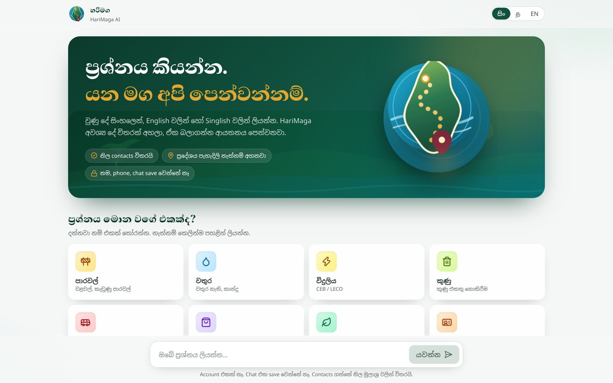
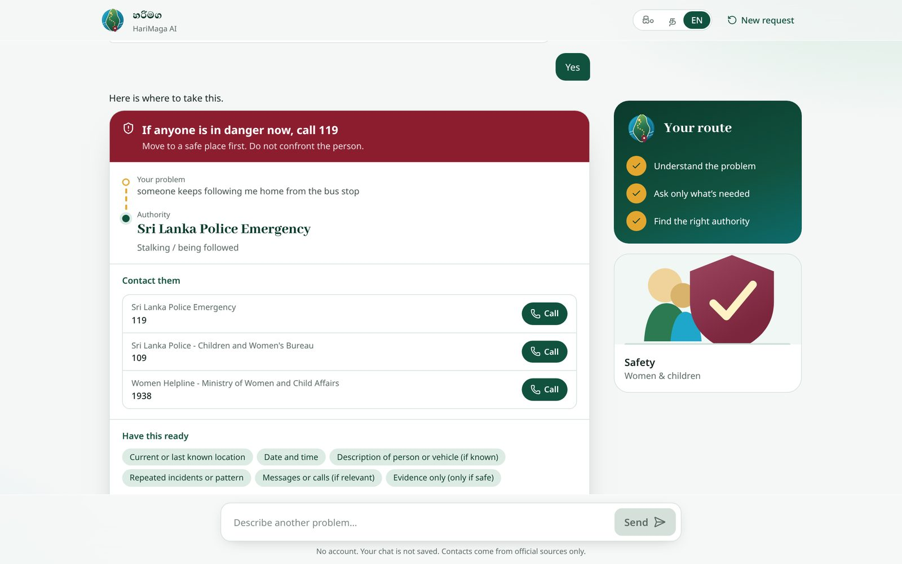
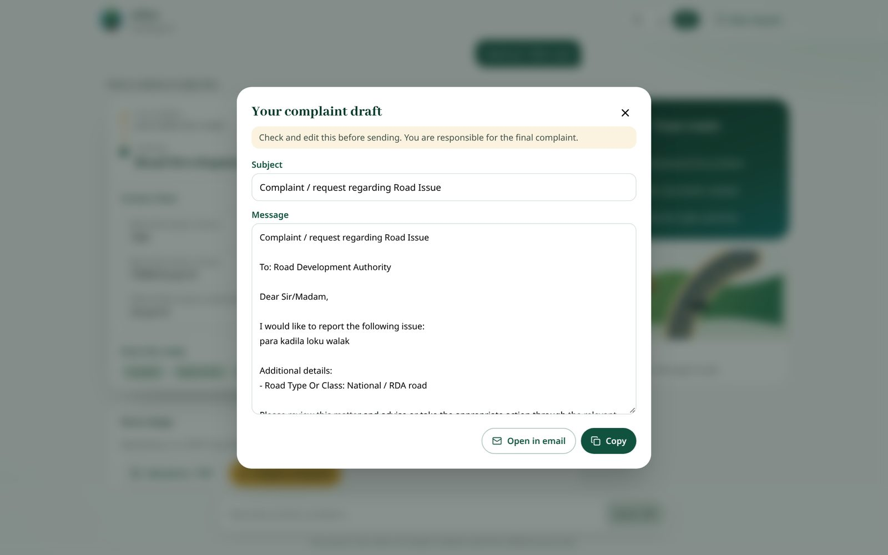
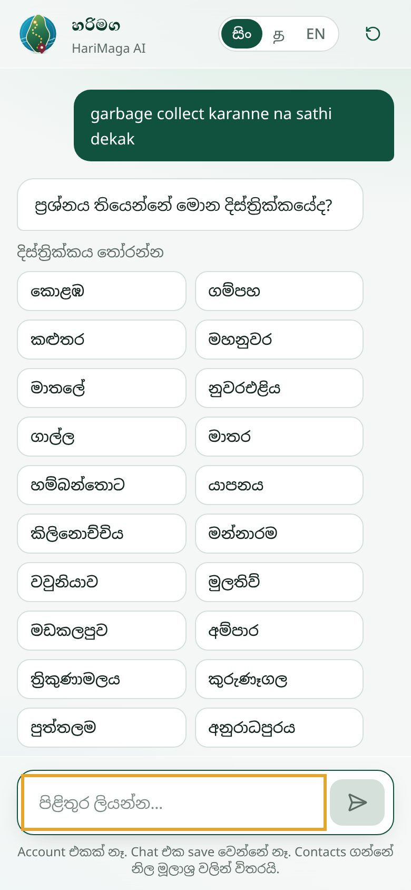
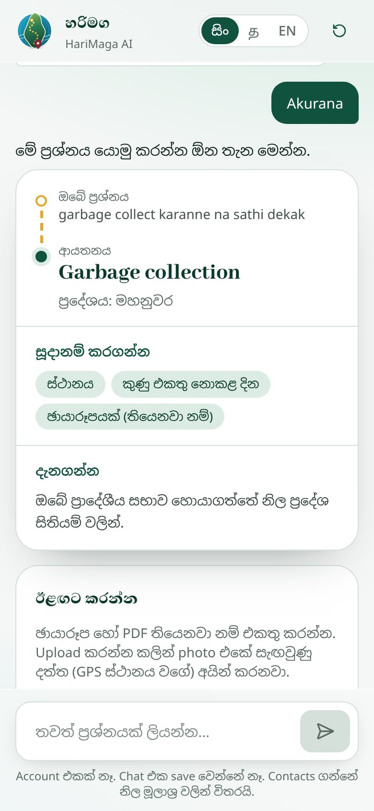
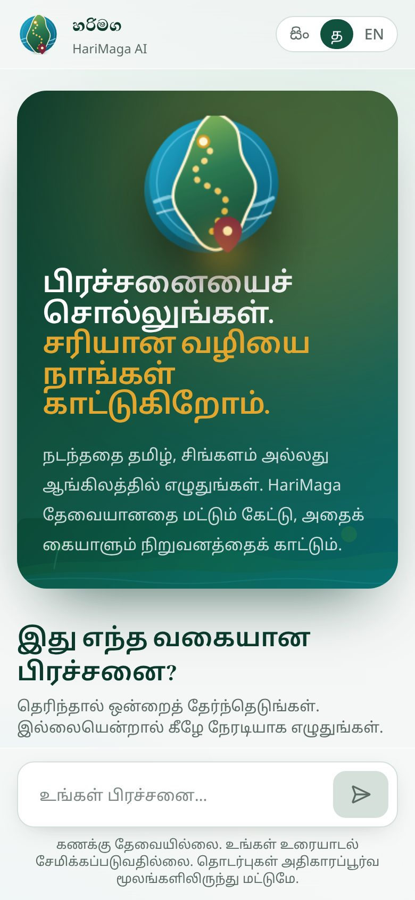
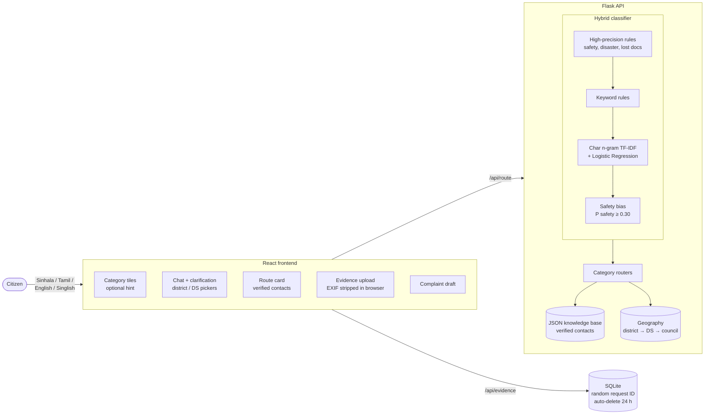

# HariMaga AI | හරිමග AI | ஹரிமக AI

> ප්‍රශ්නය කියන්න. යන මග අපි පෙන්වන්නම්.
> Tell us the problem. We'll show you the right way.

**HariMaga routes Sri Lankan citizens to the right government authority.** Describe a public-service problem in Sinhala, Tamil, English or Singlish. HariMaga works out what kind of problem it is, asks only what it needs (district, provider, road type…), and shows the authority that handles it, with **verified official contacts only**, plus an optional evidence upload and a ready-to-edit complaint draft.

**🌐 Live demo: [harimagaai.pythonanywhere.com](https://harimagaai.pythonanywhere.com)**



| Safety request (emergency banner first) | Complaint draft |
|---|---|
|  |  |

| District picker | Local council result | Tamil interface |
|---|---|---|
|  |  |  |

---

## Why

Most Sri Lankans know their problem but not *who* handles it: the RDA or the Pradeshiya Sabha for a road, CEB or LECO for power, NTC or SLTB for a bus, the Consumer Affairs Authority for a shop. Wrong-door complaints waste time, and for safety issues, time matters.

## What it does

1. **Understands the problem**: hybrid NLP classifier for 12 categories (roads, water, electricity, garbage, bus, consumer, environment, immigration, lost documents, women & child safety, disasters, other).
2. **Asks only what it needs**: e.g. *NWSDB or local scheme?*, *national or local road?*, district and Divisional Secretariat as tap-to-choose buttons.
3. **Resolves jurisdiction**: district → DS division → local authority, SLTB vs private bus, provincial vs inter-provincial routes.
4. **Shows verified contacts**: call, email, WhatsApp and official portal buttons; never invented numbers.
5. **Helps act**: attach photo/PDF evidence (GPS and camera data are stripped in the browser), and generate an editable complaint draft.

## Results

The classifier was evaluated on a **sealed test set** that was written and committed to git *before* any error analysis ([full report](reports/model_evaluation.md)).

| Full system | v9.3 (before) | **v10 (now)** |
|---|---|---|
| Accuracy | 53.3% | **80.0%** |
| Macro-F1 | 0.58 | **0.82** |
| Women & child safety recall | 20% | **100%** |
| Tamil | 8.3% | **58.3%** |

The biggest single fix came from the evaluation itself: with logistic regression's default regularisation (C=1) the class probabilities were so flat that the 0.30 confidence threshold sent **92% of ML predictions to "unknown"**. Cross-validation found C=30; together with more training data, a safety bias and rule fixes, accuracy rose by 27 points.

> **Limitation:** all evaluation sentences were written by the developer or drafted with an AI assistant, not collected from real users. See the [data collection plan](docs/data_collection_plan.md).

## Architecture



**Classification order:** safety rules → flood/landslide rules → lost-document rules → keyword rules + ML (a single keyword cannot overrule a confident ML prediction) → safety bias → category-specific Singlish rules. Safety comes first because a missed safety case costs far more than a false alarm.

## Privacy and safety by design

- No accounts, no names, no phone numbers. Chat text is never stored.
- Evidence is linked only to a random request ID and deleted automatically after 24 hours; the original file name is never saved; photos are re-drawn on a canvas so GPS and device data are removed *before* upload.
- Only anonymous 👍/👎 feedback is kept (category + yes/no + day).
- Safety results show *call 119* first and never ask for unnecessary personal details.
- Rate limiting on every endpoint; error details never reach the browser.

## Tech stack

| Layer | Technology |
|---|---|
| Frontend | React 19, TypeScript, Vite, Tailwind CSS 4, Motion (3D/animation), self-hosted Noto Sans Sinhala / Tamil + Abhaya Libre |
| Backend | Python 3.11, Flask, Flask-Limiter, Gunicorn |
| NLP / ML | scikit-learn (char n-gram TF-IDF + logistic regression), rule layers; evaluation with pandas + matplotlib; optional LaBSE comparison |
| Data | JSON knowledge bases, SQLite (evidence, feedback) |
| Quality | pytest (64 tests), GitHub Actions CI, oxlint, contact-freshness check |
| Deploy | Docker (multi-stage: Node build → Python runtime) |

## Run it locally

You need **Python 3.11** and **Node.js 20+**. Use two terminals.

```bash
# 1. Backend
python -m venv .venv
.venv\Scripts\activate            # macOS/Linux: source .venv/bin/activate
pip install -r requirements.txt
python -u webapp/backend/app.py

# 2. Frontend (second terminal)
cd frontend
npm install
npm run dev
```

Open http://localhost:5173. Vite forwards `/api` to Flask on port 5000.

**Live deployment:** PythonAnywhere free tier, see [docs/deploy_pythonanywhere.md](docs/deploy_pythonanywhere.md).

**One-container version (Docker, for any container host):**

```bash
docker build -t harimaga .
docker run -p 8000:8000 harimaga      # open http://localhost:8000
```

## Tests and evaluation

```bash
pip install -r requirements-dev.txt
pytest                                     # 64 tests: classifier, API, privacy, rate limits
python scripts/train_issue_classifier.py   # retrain the model
python scripts/evaluate_models.py          # regenerate reports/model_evaluation.md
python scripts/check_contact_freshness.py  # are official contacts older than 6 months?
```

## Project structure

```
frontend/            React app (src/components, src/hooks, src/lib)
webapp/backend/      Flask API (app.py)
nlp/                 Hybrid classifier (rules + ML)
services/            Category routers (bus, consumer, lost documents, safety, disaster…)
data/routing/        Verified authority and contact knowledge base
data/geography/      District → DS division → local authority mappings
data/training/       Training data (developer-written + AI-drafted, marked by `origin`)
data/eval/           Dev set (error analysis) and sealed test set
reports/             Evaluation report and figures
tests/               pytest suite
docs/                Screenshots, data collection plan, CI workflows
```

## Roadmap

- Collect real, anonymised user queries (opt-in) and build a real-user test set.
- Native-speaker review of all Tamil text; Tamil training data.
- Translate the remaining backend texts (lost-document steps) into Sinhala and Tamil.
- Verified contact channels for more local authorities (street lights, drainage).
- Compare with a multilingual transformer (`scripts/evaluate_transformer.py`, LaBSE).

## Author

**Sewmini Dissanayake** · BSc Computer Science with AI · [GitHub @SewminiDissanayake](https://github.com/SewminiDissanayake)

HariMaga is an independent student project and is not affiliated with the Government of Sri Lanka. Contact details come from official sources (see `source_urls` in the data); always confirm with the authority.
