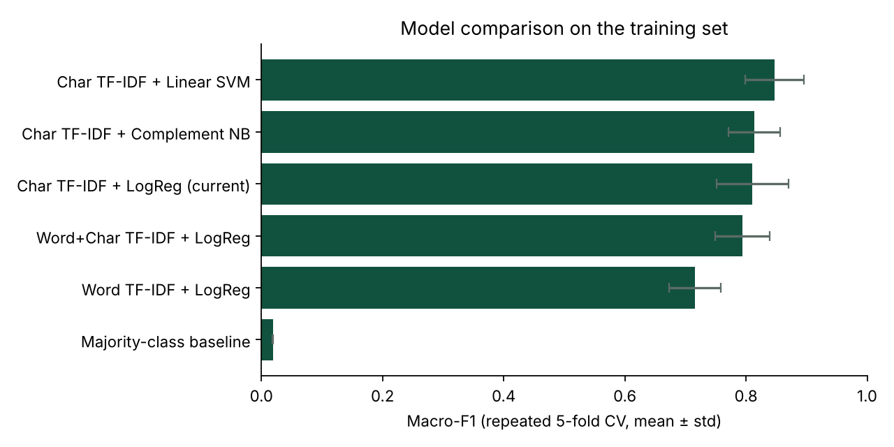
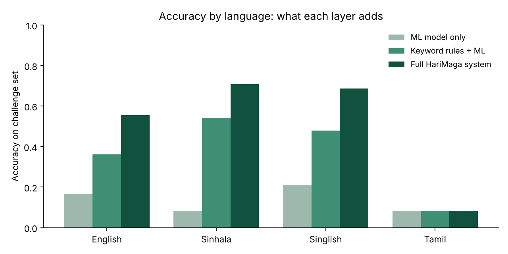
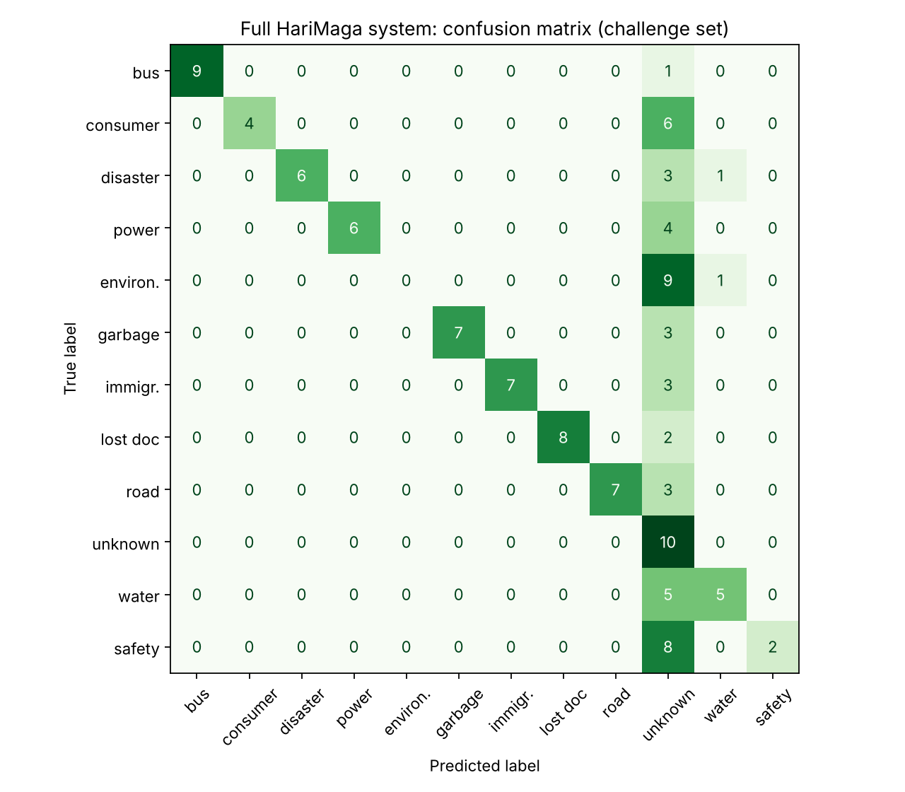
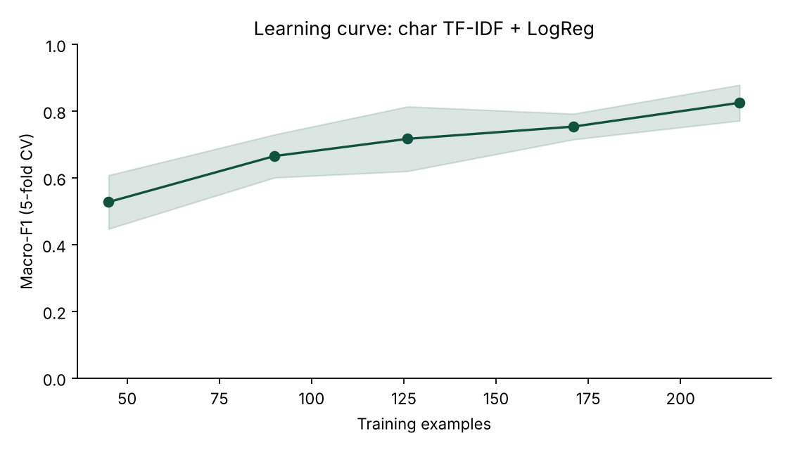

# HariMaga AI: Model Evaluation Report

_Generated by `scripts/evaluate_models.py`. Re-run it after changing the data or models._

## Data

- **Training set:** 216 examples, 9 categories (singlish: 92, si: 64, en: 54, mixed: 6).
- **Challenge set:** 120 held-out examples, 12 categories × 10, (singlish: 48, en: 36, si: 24, ta: 12).
  None of them is a near-duplicate of a training example (checked with a 0.8 similarity cut-off).
- **Limitation:** both sets were written by the developers (the challenge set was drafted with an AI assistant), not collected from real users. The numbers below show how the system behaves on realistic phrasing, not how it performs in production. Replacing the challenge set with real, anonymised user queries is the most important next step.

## 1. Model comparison (repeated stratified 5-fold cross-validation, 5×3 = 15 runs)

| Model | Accuracy | Macro-F1 |
|---|---|---|
| Char TF-IDF + Linear SVM | 85.2% ± 4.7% | 0.847 ± 0.048 |
| Char TF-IDF + Complement NB | 81.9% ± 4.3% | 0.814 ± 0.043 |
| Char TF-IDF + LogReg (current) | 81.6% ± 5.9% | 0.811 ± 0.059 |
| Word+Char TF-IDF + LogReg | 80.1% ± 4.6% | 0.794 ± 0.045 |
| Word TF-IDF + LogReg | 72.5% ± 4.1% | 0.715 ± 0.042 |
| Majority-class baseline | 9.3% ± 0.1% | 0.019 ± 0.000 |

Best in cross-validation: **Char TF-IDF + Linear SVM** (macro-F1 0.847).

### Same models on unseen challenge sentences (90 examples, the 9 categories the models were trained on)

| Model | Accuracy | Macro-F1 |
|---|---|---|
| Char TF-IDF + LogReg (current) | 80.0% | 0.809 |
| Char TF-IDF + Linear SVM | 80.0% | 0.807 |
| Char TF-IDF + Complement NB | 78.9% | 0.795 |
| Word+Char TF-IDF + LogReg | 77.8% | 0.783 |
| Word TF-IDF + LogReg | 74.4% | 0.749 |
| Majority-class baseline | 11.1% | 0.022 |

The gap between cross-validation and challenge-set scores shows how much the models rely on phrasing that is similar to the training examples.

## 2. Ablation: what each layer of the system contributes (challenge set, all 12 categories)

| System | Accuracy | Macro-F1 | English | Sinhala | Singlish | Tamil | Safety recall |
|---|---|---|---|---|---|---|---|
| ML model only | 15.8% | 0.135 | 16.7% | 8.3% | 20.8% | 8.3% | 0.0% |
| Keyword rules + ML | 41.7% | 0.407 | 36.1% | 54.2% | 47.9% | 8.3% | 0.0% |
| Full HariMaga system | 59.2% | 0.633 | 55.6% | 70.8% | 68.8% | 8.3% | 20.0% |

_Safety recall_ = share of real women/child-safety cases that the system routed to the safety flow. For this category a miss is far more costly than a false alarm.

### Full system: per-category results

| Category | Precision | Recall | F1 |
|---|---|---|---|
| bus_complaint | 1.00 | 0.90 | 0.95 |
| consumer_complaint | 1.00 | 0.40 | 0.57 |
| disaster_alert | 1.00 | 0.60 | 0.75 |
| electricity_issue | 1.00 | 0.60 | 0.75 |
| environment_issue | 0.00 | 0.00 | 0.00 |
| garbage_collection | 1.00 | 0.70 | 0.82 |
| immigration_issue | 1.00 | 0.70 | 0.82 |
| lost_document | 1.00 | 0.80 | 0.89 |
| road_issue | 1.00 | 0.70 | 0.82 |
| unknown_government_issue | 0.18 | 1.00 | 0.30 |
| water_issue | 0.71 | 0.50 | 0.59 |
| women_child_safety | 1.00 | 0.20 | 0.33 |

### Full system: all 49 errors

| Text | Language | Expected | Predicted |
|---|---|---|---|
| Road surface washed away after rain near the junction | en | road_issue | unknown_government_issue |
| para hadanna kiyala kiyanna kohetada | singlish | road_issue | unknown_government_issue |
| எங்கள் வீதியில் பெரிய குழிகள் உள்ளன | ta | road_issue | unknown_government_issue |
| We haven't had tap water since yesterday morning | en | water_issue | unknown_government_issue |
| The water coming from the tap is muddy and smells | en | water_issue | unknown_government_issue |
| Low water pressure every evening in our housing scheme | en | water_issue | unknown_government_issue |
| water bill eka godak wadi wela awe | singlish | water_issue | unknown_government_issue |
| எங்கள் வீட்டுக்கு மூன்று நாட்களாக தண்ணீர் வரவில்லை | ta | water_issue | unknown_government_issue |
| Power has been out in our lane since 6pm | en | electricity_issue | unknown_government_issue |
| Sparks coming from the power line near our house | en | electricity_issue | unknown_government_issue |
| light bill eka wadi wela | singlish | electricity_issue | unknown_government_issue |
| எங்கள் பகுதியில் மின்சாரம் இல்லை | ta | electricity_issue | unknown_government_issue |
| The council truck skips our road every week | en | garbage_collection | unknown_government_issue |
| Rubbish is piling up near the bus stand and stinks | en | garbage_collection | unknown_government_issue |
| குப்பை சேகரிக்கும் வண்டி வரவில்லை | ta | garbage_collection | unknown_government_issue |
| பேருந்து நடத்துனர் மீதி பணம் தரவில்லை | ta | bus_complaint | unknown_government_issue |
| The pharmacy is selling medicine above the maximum retail price | en | consumer_complaint | unknown_government_issue |
| කඩේ මිල දර්ශනය කරලා නෑ වැඩිපුර ගත්තා | si | consumer_complaint | unknown_government_issue |
| අලුතින් ගත්ත fan එක දවසින් කැඩුණා කඩේ මාරු කරන්නේ නෑ | si | consumer_complaint | unknown_government_issue |
| gas cylinder ekata wadi ganak gaththa | singlish | consumer_complaint | unknown_government_issue |
| hardware eken gatta cement eka bara adui | singlish | consumer_complaint | unknown_government_issue |
| கடையில் காலாவதியான பொருள் விற்றார்கள் | ta | consumer_complaint | unknown_government_issue |
| A factory is dumping waste into the canal | en | environment_issue | unknown_government_issue |
| Someone is cutting trees illegally in the forest reserve | en | environment_issue | unknown_government_issue |
| Loud noise from a quarry blasting every morning | en | environment_issue | unknown_government_issue |
| ළඟ කම්හලෙන් කළු දුම එනවා | si | environment_issue | unknown_government_issue |
| ඇළට කම්හලේ අපජලය බෝ කරනවා | si | environment_issue | water_issue |
| sand mining karanawa ganga langa nithara | singlish | environment_issue | unknown_government_issue |
| karmanthashalawe sadda nisa nidaganna ba | singlish | environment_issue | unknown_government_issue |
| kele gas kapanawa license nathuwa | singlish | environment_issue | unknown_government_issue |
| hospital waste para ayine damala | singlish | environment_issue | unknown_government_issue |
| தொழிற்சாலை புகை காற்றை மாசுபடுத்துகிறது | ta | environment_issue | unknown_government_issue |
| ගමන් බලපත්‍රය අලුත් කරන්න කොහෙද යන්න ඕන | si | immigration_issue | unknown_government_issue |
| dual citizenship apply karanne kohomada | singlish | immigration_issue | unknown_government_issue |
| கடவுச்சீட்டு விண்ணப்பம் தாமதமாகிறது | ta | immigration_issue | unknown_government_issue |
| birth certificate eka nathi wela | singlish | lost_document | unknown_government_issue |
| எனது அடையாள அட்டை தொலைந்துவிட்டது | ta | lost_document | unknown_government_issue |
| A man keeps following me when I walk home from work | en | women_child_safety | unknown_government_issue |
| My neighbour beats his children every night | en | women_child_safety | unknown_government_issue |
| Someone is sending me threatening messages online | en | women_child_safety | unknown_government_issue |
| ළමයෙක්ව වැඩට යොදවනවා | si | women_child_safety | unknown_government_issue |
| kenek mata nithara call karala bayanawa | singlish | women_child_safety | unknown_government_issue |
| lamayata gedara aya gahanawa | singlish | women_child_safety | unknown_government_issue |
| husband gahanawa gedara inna bayai | singlish | women_child_safety | unknown_government_issue |
| ஒருவர் என்னைப் பின்தொடர்கிறார் | ta | women_child_safety | unknown_government_issue |
| Cracks appeared on the hill behind our house after rain | en | disaster_alert | unknown_government_issue |
| පිටිපස්සේ කන්දේ පස් කඩාගෙන වැටෙනවා | si | disaster_alert | unknown_government_issue |
| heavy rain nisa gewal walata wathura enawa | singlish | disaster_alert | water_issue |
| வெள்ள எச்சரிக்கை உள்ளதா | ta | disaster_alert | unknown_government_issue |

## 3. Learning curve

| Training examples | Macro-F1 |
|---|---|
| 45 | 0.528 ± 0.080 |
| 90 | 0.666 ± 0.065 |
| 126 | 0.717 ± 0.097 |
| 171 | 0.754 ± 0.038 |
| 216 | 0.825 ± 0.054 |

If the curve is still rising at 100%, more training data is likely to help.
