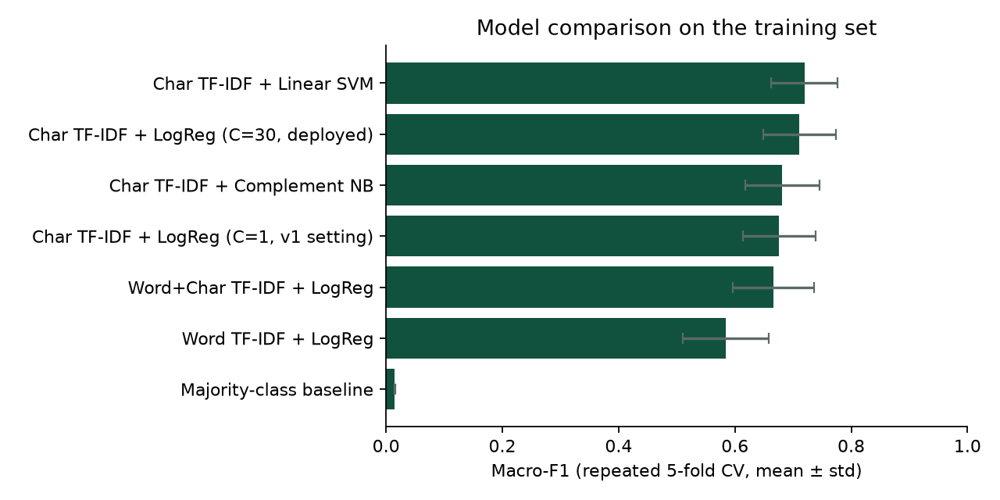
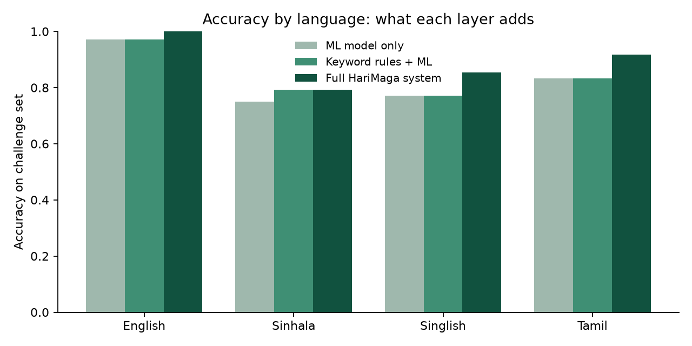
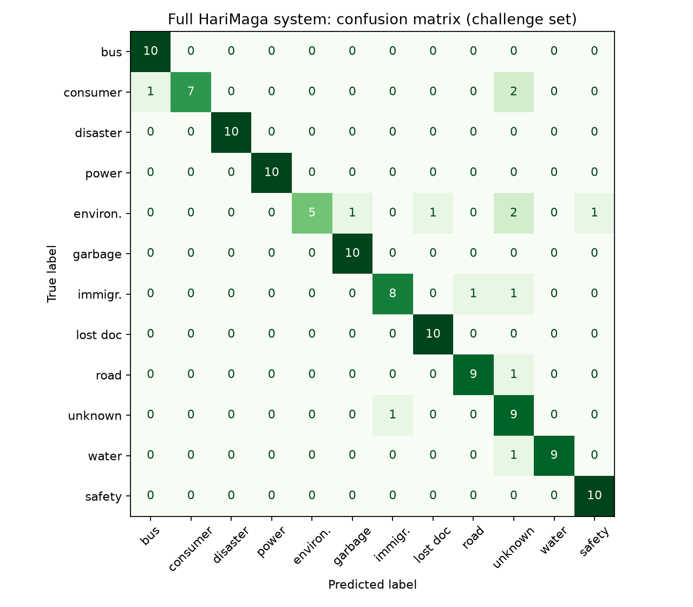
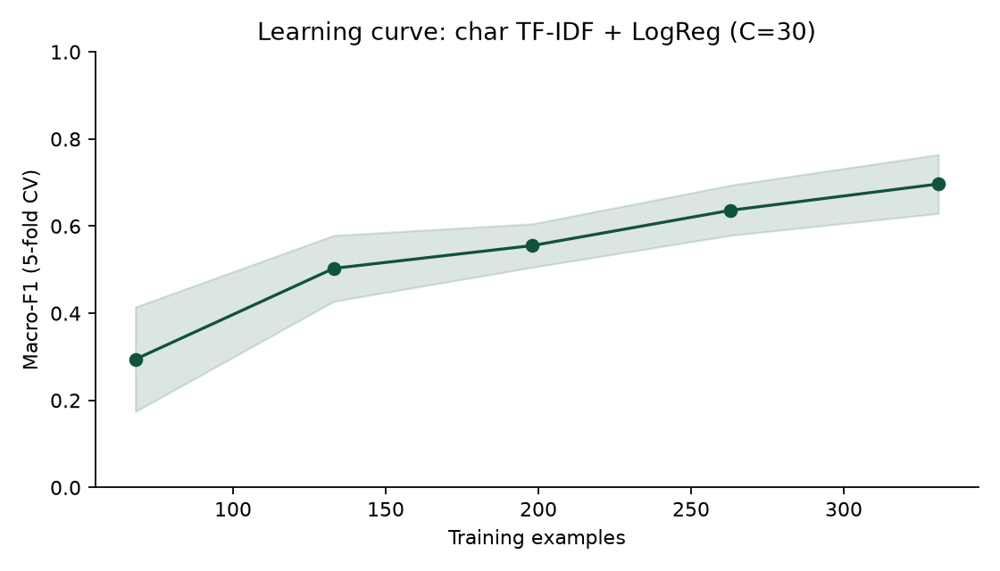

# HariMaga AI: Model Evaluation Report

_Generated by `scripts/evaluate_models.py`. Re-run it after changing the data or models._

## Data

- **Training set:** 331 examples, 12 categories (singlish: 116, en: 106, si: 78, ta: 25, mixed: 6).
- **Challenge set:** 120 held-out examples, 12 categories × 10, (singlish: 48, en: 36, si: 24, ta: 12).
  None of them is a near-duplicate of a training example (checked with a 0.8 similarity cut-off).
- **Limitation:** both sets were written by the developers (the challenge set was drafted with an AI assistant), not collected from real users. The numbers below show how the system behaves on realistic phrasing, not how it performs in production. Replacing the challenge set with real, anonymised user queries is the most important next step.

## 1. Model comparison (repeated stratified 5-fold cross-validation, 5×3 = 15 runs)

| Model | Accuracy | Macro-F1 |
|---|---|---|
| Char TF-IDF + Linear SVM | 75.3% ± 5.3% | 0.720 ± 0.057 |
| Char TF-IDF + LogReg (C=30, deployed) | 74.2% ± 5.8% | 0.711 ± 0.063 |
| Char TF-IDF + Complement NB | 72.3% ± 5.3% | 0.682 ± 0.064 |
| Char TF-IDF + LogReg (C=1, v1 setting) | 70.6% ± 5.6% | 0.676 ± 0.063 |
| Word+Char TF-IDF + LogReg | 70.2% ± 6.6% | 0.666 ± 0.070 |
| Word TF-IDF + LogReg | 61.7% ± 7.5% | 0.584 ± 0.074 |
| Majority-class baseline | 10.0% ± 0.7% | 0.015 ± 0.001 |

Best in cross-validation: **Char TF-IDF + Linear SVM** (macro-F1 0.720). The deployed model is **Char TF-IDF + LogReg (C=30)**: the difference to the best model is within one standard deviation, and HariMaga needs class *probabilities* (confidence threshold and safety bias), which a linear SVM does not provide.

### Same models on unseen challenge sentences (120 examples)

| Model | Accuracy | Macro-F1 |
|---|---|---|
| Char TF-IDF + Linear SVM | 88.3% | 0.878 |
| Char TF-IDF + LogReg (C=30, deployed) | 87.5% | 0.869 |
| Char TF-IDF + Complement NB | 85.8% | 0.855 |
| Char TF-IDF + LogReg (C=1, v1 setting) | 85.8% | 0.854 |
| Word+Char TF-IDF + LogReg | 83.3% | 0.826 |
| Word TF-IDF + LogReg | 78.3% | 0.776 |
| Majority-class baseline | 8.3% | 0.013 |

The gap between cross-validation and challenge-set scores shows how much the models rely on phrasing that is similar to the training examples.

## 2. Ablation: what each layer of the system contributes (challenge set, all 12 categories)

| System | Accuracy | Macro-F1 | English | Sinhala | Singlish | Tamil | Safety recall |
|---|---|---|---|---|---|---|---|
| ML model only | 83.3% | 0.837 | 97.2% | 75.0% | 77.1% | 83.3% | 100.0% |
| Keyword rules + ML | 84.2% | 0.844 | 97.2% | 79.2% | 77.1% | 83.3% | 100.0% |
| Full HariMaga system | 89.2% | 0.890 | 100.0% | 79.2% | 85.4% | 91.7% | 100.0% |

_Safety recall_ = share of real women/child-safety cases that the system routed to the safety flow. For this category a miss is far more costly than a false alarm.

### Full system: per-category results

| Category | Precision | Recall | F1 |
|---|---|---|---|
| bus_complaint | 0.91 | 1.00 | 0.95 |
| consumer_complaint | 1.00 | 0.70 | 0.82 |
| disaster_alert | 1.00 | 1.00 | 1.00 |
| electricity_issue | 1.00 | 1.00 | 1.00 |
| environment_issue | 1.00 | 0.50 | 0.67 |
| garbage_collection | 0.91 | 1.00 | 0.95 |
| immigration_issue | 0.89 | 0.80 | 0.84 |
| lost_document | 0.91 | 1.00 | 0.95 |
| road_issue | 0.90 | 0.90 | 0.90 |
| unknown_government_issue | 0.56 | 0.90 | 0.69 |
| water_issue | 1.00 | 0.90 | 0.95 |
| women_child_safety | 0.91 | 1.00 | 0.95 |

### Full system: all 13 errors

| Text | Language | Expected | Predicted |
|---|---|---|---|
| para hadanna kiyala kiyanna kohetada | singlish | road_issue | unknown_government_issue |
| எங்கள் வீட்டுக்கு மூன்று நாட்களாக தண்ணீர் வரவில்லை | ta | water_issue | unknown_government_issue |
| කඩේ මිල දර්ශනය කරලා නෑ වැඩිපුර ගත්තා | si | consumer_complaint | bus_complaint |
| අලුතින් ගත්ත fan එක දවසින් කැඩුණා කඩේ මාරු කරන්නේ නෑ | si | consumer_complaint | unknown_government_issue |
| hardware eken gatta cement eka bara adui | singlish | consumer_complaint | unknown_government_issue |
| ළඟ කම්හලෙන් කළු දුම එනවා | si | environment_issue | unknown_government_issue |
| sand mining karanawa ganga langa nithara | singlish | environment_issue | women_child_safety |
| karmanthashalawe sadda nisa nidaganna ba | singlish | environment_issue | unknown_government_issue |
| kele gas kapanawa license nathuwa | singlish | environment_issue | lost_document |
| hospital waste para ayine damala | singlish | environment_issue | garbage_collection |
| ගමන් බලපත්‍රය අලුත් කරන්න කොහෙද යන්න ඕන | si | immigration_issue | road_issue |
| dual citizenship apply karanne kohomada | singlish | immigration_issue | unknown_government_issue |
| ඉඩම් ඔප්පුවක් ගැන ප්‍රශ්නයක් තියෙනවා | si | unknown_government_issue | immigration_issue |

## 3. Learning curve

| Training examples | Macro-F1 |
|---|---|
| 68 | 0.294 ± 0.120 |
| 133 | 0.503 ± 0.076 |
| 198 | 0.555 ± 0.050 |
| 263 | 0.636 ± 0.058 |
| 331 | 0.697 ± 0.068 |

If the curve is still rising at 100%, more training data is likely to help.

## 4. Before vs after (full system)

The **sealed test set** (`data/eval/harimaga_test_v2_sealed.csv`) was written and committed to git *before* any error analysis, and was only used to produce these final numbers. The dev set was used to find errors, so its "after" numbers are optimistic.

| Metric | Dev v1: v9.3 | Dev v1: v10 | **Test v2: v9.3** | **Test v2: v10** |
|---|---|---|---|---|
| Accuracy | 59.2% | 89.2% | 53.3% | **80.0%** |
| Macro-F1 | 0.633 | 0.890 | 0.582 | **0.817** |
| English | 55.6% | 100.0% | 50.0% | **100.0%** |
| Sinhala | 70.8% | 79.2% | 75.0% | **83.3%** |
| Singlish | 68.8% | 85.4% | 66.7% | **79.2%** |
| Tamil | 8.3% | 91.7% | 8.3% | **58.3%** |
| Safety recall | 20.0% | 100.0% | 20.0% | **100.0%** |

### What changed in v10

1. **Model regularisation:** C=1 → C=30. With C=1 the median top probability was 0.17, so the 0.30 confidence threshold sent 92% of ML predictions to "unknown" (CV macro-F1 0.215 with the threshold vs 0.811 without). Threshold lowered to 0.25. Both chosen by cross-validation on training data only.
2. **Train on all data:** v1 kept 25% of rows out of the saved model.
3. **Training data v2:** 115 AI-drafted examples (marked `origin` in the CSV) for the three categories the model had never seen (safety, disaster, lost documents), Tamil and English for every category, and contrast examples (e.g. "threatening to cut trees" = environment).
4. **Safety bias:** if the ML probability of safety is ≥ 0.30 the request goes to the safety flow, because a missed safety case costs far more than a false alarm.
5. **Rule fixes:** bare `ජල` no longer matches `අපජලය` (wastewater); one keyword can no longer overrule a confident (≥ 0.5) ML prediction; new safety, flood, landslide and lost-document patterns in English, Singlish, Sinhala and Tamil.

### Honest limitations

- All evaluation sentences were written by the developers / an AI assistant, who also wrote the rules. Even with a sealed test set this can flatter the results. **Real, anonymised user queries are needed for a trustworthy estimate** (the in-app 👍/👎 feedback shows which categories to collect first).
- Tamil training and test sentences should be reviewed by a native speaker.
- The safety bias produces some false alarms (e.g. Singlish sentences with "nithara"). This is a deliberate trade-off.
